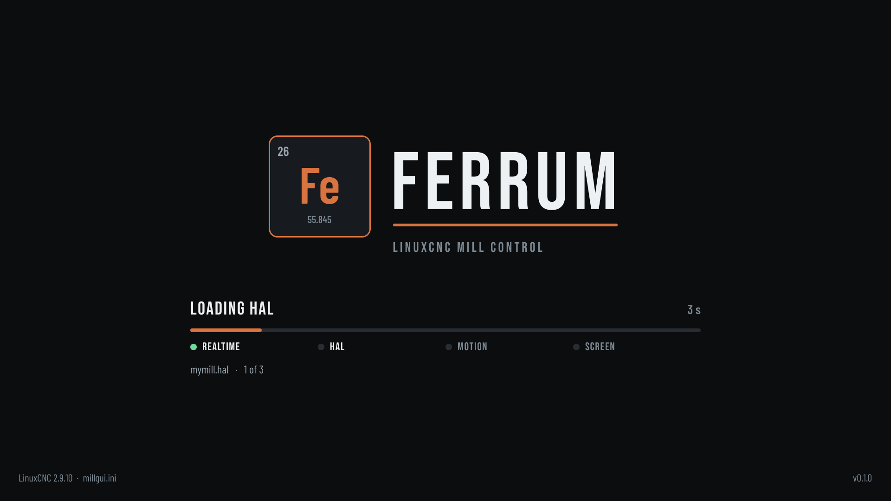
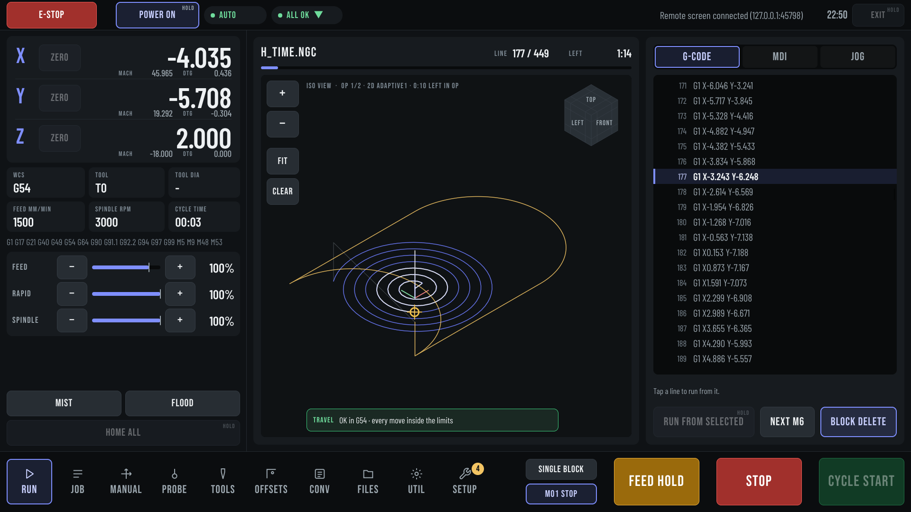
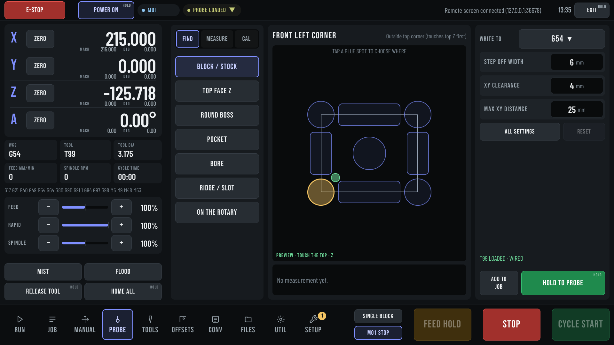
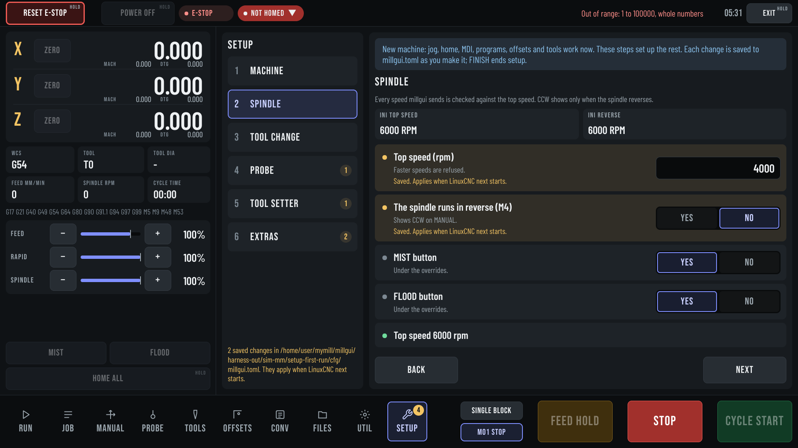

<p align="center">
  
</p>

# Ferrum

A touchscreen control for [LinuxCNC](https://linuxcnc.org) mills, written in Rust with [Slint](https://slint.dev).

Ferrum is the screen you stand in front of: big targets, one job per screen, and nothing that needs a mouse or a keyboard. It talks to LinuxCNC directly, with no Python, and runs on a Raspberry Pi 5.



> **Status: early.** Ferrum runs its author's mill, and it is being split out of the machine config it grew up in. The binary and its settings file are still called `millgui`. Expect names and paths to move.

## What it does

- **Run.** A 3D backplot with the tool, the trail and each operation in its own colour. Time left for the program and the current op. Run from a line you tap.
- **Travel check.** Before CYCLE START, every move of the program is checked against your soft limits with today's work offsets. An overrun is refused, with the line that causes it.
- **Probe.** Pick a shape, tap where to touch, hold to probe. A preview plays the routine before the machine moves. Edges, corners, bosses, bores, pockets, ridges, slots and a rotary axis.
- **Tools.** Edit the tool table on screen. With a tool setter, MEASURE sets a tool's length and CHECK catches a broken one.
- **Jobs.** Chain probing steps, conversational operations and CAM programs into one job. Skip an op, start at an op, or stop after one. A probing step can measure a feature and pause when it is out of tolerance.
- **Conversational.** Facing, hole patterns, helical bores and thread milling without CAM.
- **Manual.** Jog, power feed, go-to positions, MDI with a searchable G-code library, and a keypad that does arithmetic.
- **Setup.** A guided SETUP screen checks your machine and switches features on as their requirements are met.
- **Browser screen.** The same UI in a browser on your LAN, compiled to WebAssembly. Off by default.

| Probe | Setup |
| --- | --- |
|  |  |

Ferrum is built to keep you out of trouble, not to keep the machine safe. Destructive buttons need a hold, and buttons that cannot apply are disabled. Limits, interlocks and the e-stop chain stay where they belong, in LinuxCNC, HAL and hardware, so a GUI bug cannot defeat them.

## Requirements

- LinuxCNC 2.9 (tested with 2.9.10, uspace) on Linux with X11.
- A mill LinuxCNC already runs: XYZ, with an optional rotary A or a gantry. Metric or inch.
- A 1920×1080 touchscreen. The layout scales to other sizes.
- A recent stable Rust toolchain to build it.

A probe and a tool setter are optional. Without them those screens stay off and the rest works.

Ferrum is developed on a Raspberry Pi 5. It draws on the GPU where there is one and has a software renderer where there is not.

## Try it without a machine

No LinuxCNC needed, on Linux or macOS. This opens a window on a built-in simulated machine:

```sh
cargo run --release -p millgui -- --sim --windowed
```

## Install

Build on the machine that runs LinuxCNC, pointing the build at LinuxCNC's headers and libraries:

```sh
LCNC_INCLUDE_DIR=/usr/include/linuxcnc LCNC_LIB_DIR=/usr/lib cargo build --release -p millgui
```

Then make Ferrum the display in your INI:

```ini
[DISPLAY]
DISPLAY = /path/to/ferrum/run
```

Check what Ferrum makes of your machine. This works with LinuxCNC stopped and changes nothing:

```sh
millgui --check ~/linuxcnc/configs/mymachine/mymachine.ini
```

It prints what it read, what is missing and which features are off because of it. Add `--write-ini` and it adds the INI lines it asks for, keeping the old file as `mymachine.ini.bak`.

## Run

```sh
./boot ~/linuxcnc/configs/mymachine/mymachine.ini
```

`boot` opens the screen at once and starts LinuxCNC underneath, showing each step as it happens. If LinuxCNC fails to start, the splash says why and offers TRY AGAIN.

`linuxcnc mymachine.ini` works as it always has. The splash then only covers Ferrum connecting.

On a new machine SETUP opens first. Jogging, homing, MDI, programs, offsets and tools work straight away, and SETUP walks through the rest.

## Configuration

LinuxCNC's settings stay in your INI: axes, units, limits, speeds and paths. Ferrum only reads them.

What LinuxCNC does not know lives in one file beside the INI, `millgui.toml`. Every key is optional, and the SETUP screen writes it for you:

```toml
[modules]
enabled = "run job manual probe tools offsets conv files util"

[spindle]
max_rpm = 6000

[probe]
tool = 99

[toolsetter]
max_z = 120

[hal]
probe_tripped = "motion.probe-input"
```

Each screen is a module. Leave one out and it is never created: no nav entry, no HAL pins. The full list of keys is in [docs/millgui-toml.md](docs/millgui-toml.md).

Ferrum ships its own probing macros in [`macros/`](macros/). They need no HAL pins beyond the probe input, and they work in mm or inch.

## Testing

The harness boots a real LinuxCNC 2.9.10 simulator with Ferrum as its display, drives the screen, and checks LinuxCNC's own status, HAL pins and screenshots. It runs every scenario on several machines: metric, inch, rotary and gantry. Probing routines are checked against simulated parts with known dimensions. It never talks to a real machine.

```sh
harness/setup-linuxcnc    # once: builds LinuxCNC 2.9.10
harness/run               # every machine, every scenario
```

On macOS, or anywhere with Docker:

```sh
harness/docker-run
```

The report lands in `harness-out/index.html`. See [harness/README.md](harness/README.md) for how to write a scenario.

## Inside

```
app/              the Slint UI and feature modules
crates/lcnc/      standalone LinuxCNC bindings: typed status, commands, messages, HAL pins
crates/machine/   the Machine trait: LinuxCNC or the built-in simulator
crates/preview/   G-code interpreter to toolpath, travel check, backplot renderers
crates/jobcore/   the job builder
macros/           probing and tool setter routines
harness/          end-to-end tests
```

[`crates/lcnc`](crates/lcnc/) stands on its own. If you want to write a different LinuxCNC front end in Rust, start there.

## License

Ferrum's source is [MIT](LICENSE) licensed, macros included.

A Ferrum binary links LinuxCNC's `libnml`, which is GPL-2.0. A binary you distribute is therefore covered by the GPL's terms as well. The MIT source is compatible with that.

Ferrum is an independent project and is not part of LinuxCNC.
